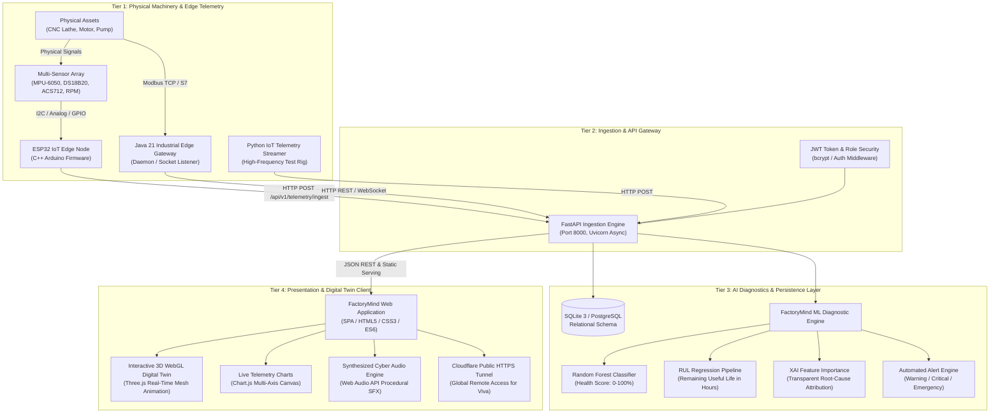
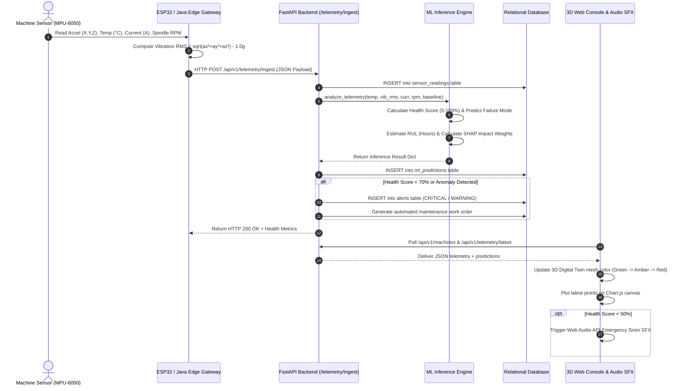
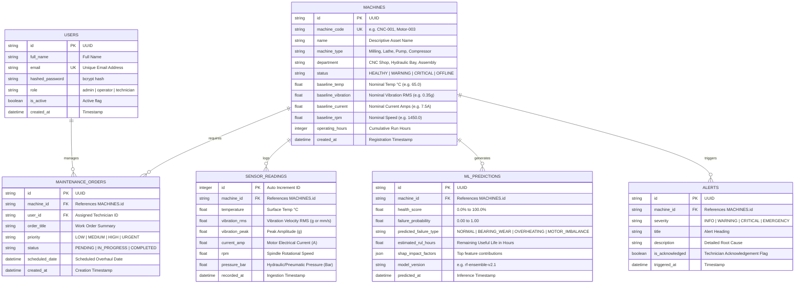

# FactoryMind AI — Complete System Architecture Blueprint
**Department of Computer Applications, TKIET, Warananagar**  
**SY MCA Major Project (Academic Year: 2026–2027)**  
*Project Title: FactoryMind AI: An AI-Based Predictive Manufacturing and Machine Health Monitoring Platform*

---

## 1. High-Level Cyber-Physical Architecture (4-Tier Model)

FactoryMind AI is structured around a 4-Tier cyber-physical architecture connecting industrial physical assets on the factory floor to an intelligent web console with 3D spatial twin visualization.



---

## 2. Component Workflow & Data Sequence

The end-to-end lifecycle of a sensor reading from physical mechanical vibration to browser alert is shown below:



---

## 3. Database Entity Relationship (ER) Schema

FactoryMind AI uses an ACID-compliant relational database schema with full foreign key constraints and automated cascade updates.



---

## 4. API Endpoints Contract Matrix

All endpoints are hosted by FastAPI at `http://127.0.0.1:8000` with interactive Swagger UI at `/api/v1/docs`:

| Method | Endpoint | Access Role | Description |
|---|---|---|---|
| `POST` | `/api/v1/auth/login` | Public | Authenticates user credentials via JWT Bearer Token |
| `GET` | `/api/v1/auth/me` | Authenticated | Retrieves current logged-in user profile & role |
| `GET` | `/api/v1/machines/` | Authenticated | Lists all machines with live status and latest sensor metrics |
| `POST` | `/api/v1/machines/` | Admin | Registers a new physical or virtual industrial machine |
| `GET` | `/api/v1/machines/{id}` | Authenticated | Retrieves single machine details and historical diagnostic metrics |
| `POST` | `/api/v1/telemetry/ingest` | Public / Edge | **Primary Ingestion API:** Receives sensor readings, triggers ML inference & alerts |
| `GET` | `/api/v1/telemetry/latest/{code}`| Authenticated | Retrieves the most recent telemetry frame for a machine |
| `GET` | `/api/v1/predictions/` | Authenticated | Lists ML predictions, anomaly probabilities, and RUL forecasts |
| `GET` | `/api/v1/alerts/` | Authenticated | Lists all active and historical alerts filtered by severity |
| `PUT` | `/api/v1/alerts/{id}/ack` | Technician/Admin| Acknowledges an active alert and silences sirens |
| `GET` | `/api/v1/maintenance/` | Authenticated | Lists maintenance work orders and technician assignments |
| `POST` | `/api/v1/maintenance/` | Manager/Admin | Dispatches a new corrective maintenance ticket |
| `GET` | `/api/v1/analytics/overview` | Authenticated | Aggregates plant-wide OEE, health index, and failure breakdowns |
| `GET` | `/presentation` | Public | Serves the SY MCA Review-II Widescreen Interactive Slide Deck |
| `GET` | `/download-ppt` | Public | Direct one-click download of the official Microsoft PowerPoint `.pptx` file |

---

## 5. Technology Stack Specifications

```
+-------------------------------------------------------------------------------+
|                             FACTORYMIND AI STACK                              |
+-------------------------------------------------------------------------------+
|  TIER 1 (IoT & Edge)       |  ESP32 C++ Firmware (WiFi, HTTPClient, ArduinoJson)|
|                            |  Java 21 LTS Edge Gateway (Sockets, Modbus)       |
|                            |  Python High-Frequency IoT Telemetry Simulator   |
+----------------------------+--------------------------------------------------+
|  TIER 2 (Backend & APIs)   |  Python 3.12 64-bit                              |
|                            |  FastAPI (Asynchronous REST & WebSockets)        |
|                            |  Uvicorn ASGI Web Server                         |
|                            |  Pydantic v2 (Strict Schema Data Validation)      |
+----------------------------+--------------------------------------------------+
|  TIER 3 (AI/ML & DB)       |  Scikit-Learn (Random Forest & Gradient Boost)   |
|                            |  NumPy & SciPy (Signal Processing & RMS Math)    |
|                            |  SQLAlchemy 2.0 ORM                              |
|                            |  SQLite 3 (Development) / PostgreSQL (Production) |
+----------------------------+--------------------------------------------------+
|  TIER 4 (Frontend UI/UX)   |  HTML5 & CSS3 Glassmorphism UI (Zero-Build SPA)  |
|                            |  Three.js WebGL (Interactive 3D Digital Twin)    |
|                            |  Chart.js (High-Speed Time-Series Telemetry)     |
|                            |  Web Audio API (Synthesized Procedural SFX)       |
+----------------------------+--------------------------------------------------+
|  NETWORKING & TUNNELING    |  Cloudflare Named/Quick Tunnels (Free HTTPS)     |
|                            |  Localhost Bindings (127.0.0.1:8000)             |
|                            |  start_all.bat (One-Click Windows Orchestrator)  |
+-------------------------------------------------------------------------------+
```

---

## 6. Project Directory File Map

```
C:\Users\Pratiksha\.gemini\antigravity\scratch\factorymind\
│
├── start_all.bat                        <-- Master 1-Click Platform Launcher (Options 1-9)
├── run_free_domain.bat                  <-- Free Public HTTPS Cloudflare Tunnel Launcher
├── run_java_gateway.bat                 <-- Java 21 Industrial Edge Gateway Launcher
├── FactoryMind_AI_SY_MCA_Second_Presentation.pptx  <-- Official Microsoft PowerPoint File
├── presentation.html                    <-- 16:9 Interactive Presentation Slide Deck
├── FACTORYMIND_SECOND_PRESENTATION_PPT.md <-- Slide-by-Slide Viva Speaking Notes
├── HARDWARE_IOT_GUIDE.md                <-- Complete Hardware Wiring & Price Guide
├── hardware_esp32_firmware.ino          <-- Ready-to-flash Arduino C++ Code for ESP32
├── PROJECT_BLUEPRINT.md                 <-- This Complete Architecture Blueprint
│
├── backend/
│   ├── app/
│   │   ├── main.py                      <-- FastAPI Application & Static Mounts
│   │   ├── core/
│   │   │   ├── config.py                <-- Environment & CORS Configuration
│   │   │   ├── database.py              <-- SQLAlchemy Session & Database Engine
│   │   │   └── security.py              <-- Password Hashing & JWT Token Generation
│   │   ├── models/
│   │   │   └── models.py                <-- Database Models (Machines, Telemetry, Alerts)
│   │   ├── schemas/
│   │   │   └── schemas.py               <-- Pydantic Ingest & Response Schemas
│   │   ├── api/
│   │   │   ├── auth.py                  <-- Login & Current User Endpoints
│   │   │   ├── machines.py              <-- Machine Management Endpoints
│   │   │   ├── telemetry.py             <-- Telemetry Ingestion & Real-Time Query
│   │   │   ├── predictions.py           <-- ML Diagnostics & RUL Forecasts
│   │   │   ├── alerts.py                <-- Machine Health Alerts & Acknowledgements
│   │   │   ├── maintenance.py           <-- Maintenance Work Orders
│   │   │   ├── analytics.py             <-- Factory OEE & Health Summary
│   │   │   └── copilot.py               <-- AI Diagnostic Assistant
│   │   └── ml/
│   │       └── engine.py                <-- Random Forest & RUL Prediction Engine
│   ├── simulator/
│   │   └── iot_simulator.py             <-- High-Frequency Multi-Machine IoT Simulator
│   ├── static/
│   │   ├── index.html                   <-- 3D Digital Twin & Live Telemetry Dashboard
│   │   ├── login.html                   <-- Standalone Authentication Portal
│   │   ├── presentation.html            <-- Slide Deck Host
│   │   └── FactoryMind_AI_SY_MCA_Second_Presentation.pptx <-- Downloadable Presentation
│   └── seed_data.py                     <-- Seeds 6 Machines & Initial Sensor Readings
│
└── edge_gateway/
    └── src/
        └── FactoryEdgeGateway.java      <-- Java 21 High-Throughput Edge Daemon
```
